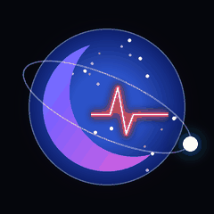
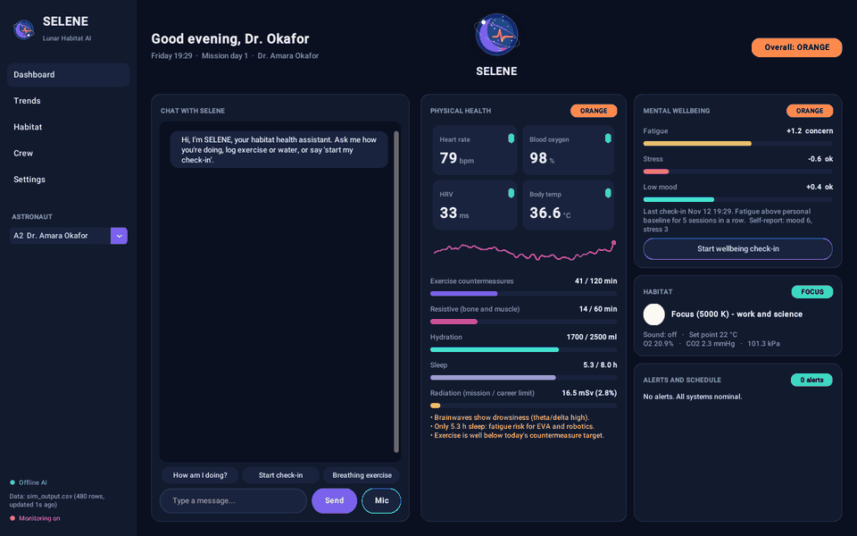
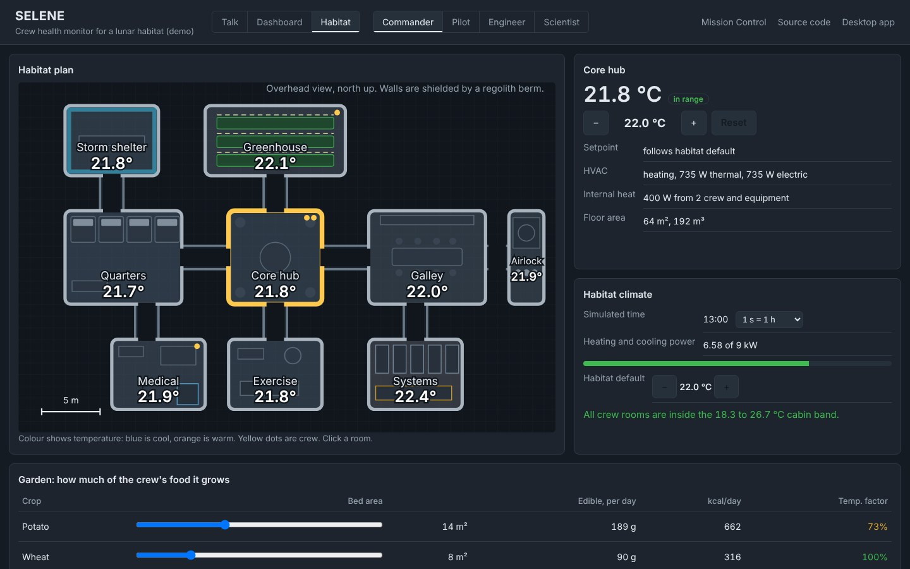
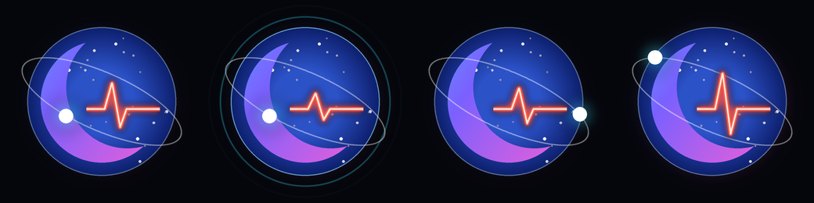
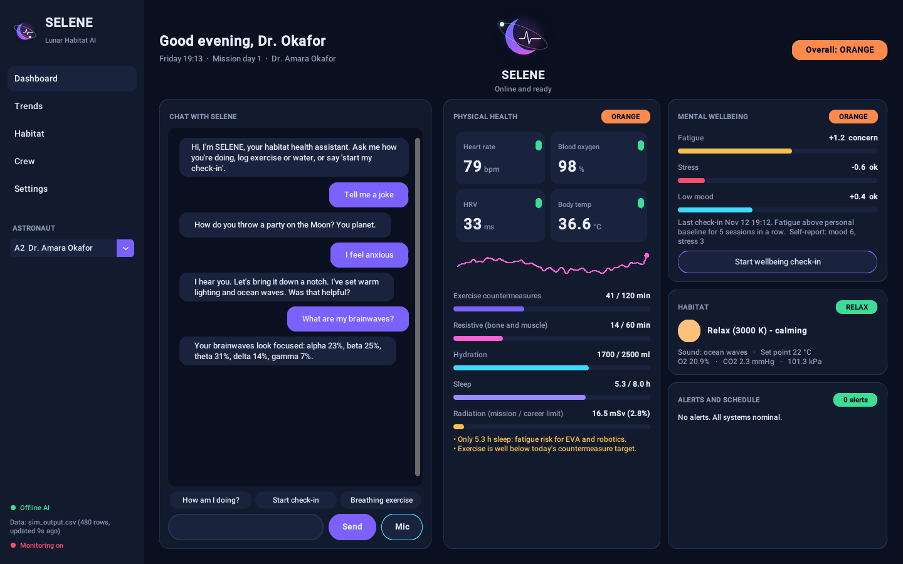
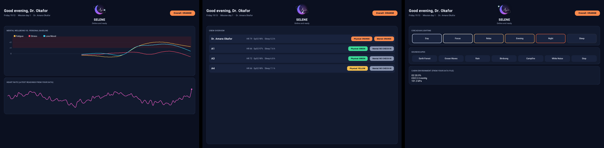
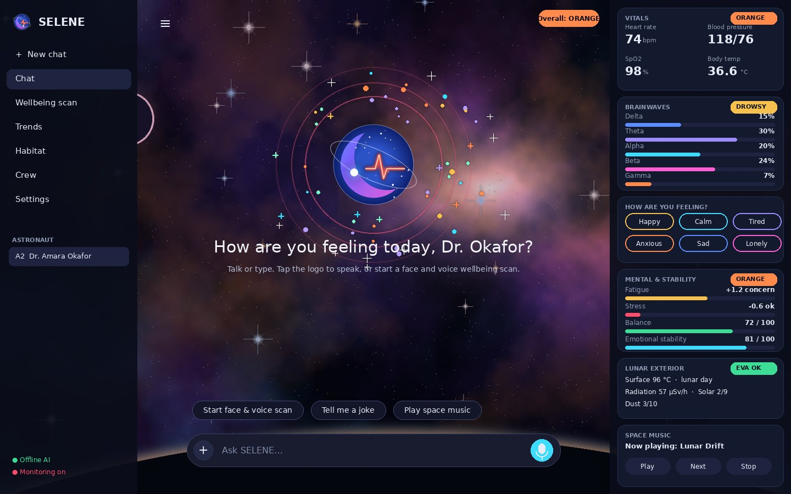
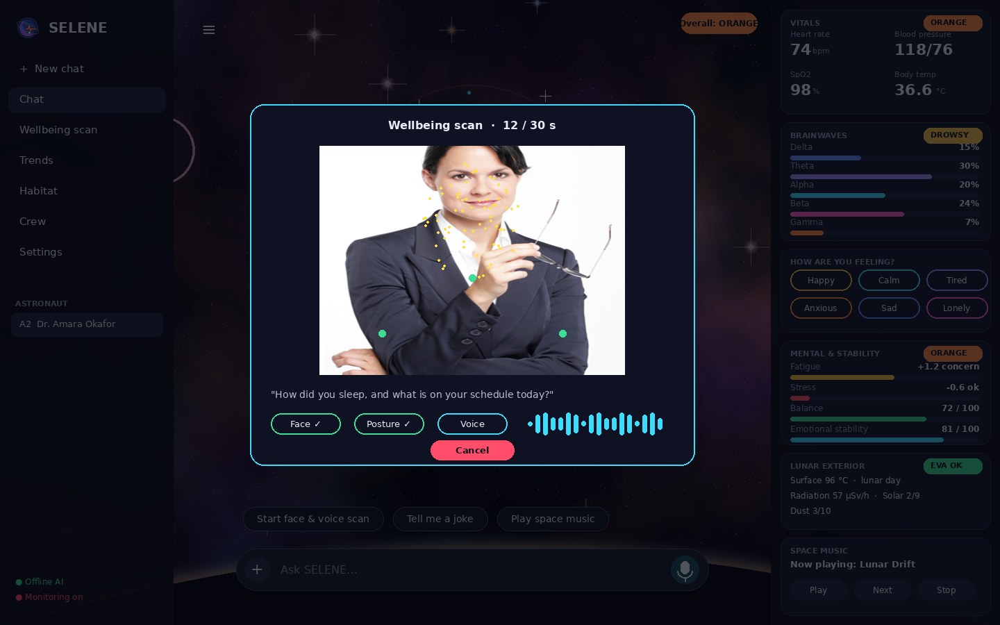

<div align="center">



# SELENE: Lunar Habitat AI

**S**pace **E**nvironment **L**ife & **N**euro-health **E**ngine: an AI health companion for astronauts on the Moon.


</div>

---

## 🌐 Try it in your browser (no download)

<div align="center">

[](https://jaigod.github.io/lunar-crew-monitor/)
[](https://jaigod.github.io/LunarSmartAdaptiveHabitat/)

</div>

**SELENE Web** has three tabs:

| Tab | What it is |
|---|---|
| **Talk** | The AI assistant: a particle Moon that reacts while it listens and speaks, text and voice chat ("Hey Selene"), mood check-ins, a breathing coach. |
| **Dashboard** | The crew's vitals, brainwaves, camera face check-in, circadian lighting, cabin air, lunar exterior, alerts and a crew table. |
| **Habitat** | A 2D plan of the base with a temperature model for every room, a garden that shows how much of the crew's food it can grow, and a way to connect a heart-rate device. |

It runs in any modern browser with nothing to install, and it is part of the **Project ARES** lunar
habitat (simulation SIM-07 on the [Mission Control website](https://jaigod.github.io/LunarSmartAdaptiveHabitat/)).
The crew data in the web version is simulated. The **Habitat tab is web only**; the Windows and Mac
desktop app has the Talk and Dashboard features but not the Habitat plan.

## 🤖 AI mode (Claude or free AI)

On the web version, click **AI mode** under the chat box to connect an AI. SELENE then talks naturally, while her onboard rules still run every command (logging water, exercise and sleep, lights, music, check-ins) on your device.

| AI | Cost |
|---|---|
| Claude (Anthropic) | Paid API key |
| Gemini (Google) | Free key from aistudio.google.com |
| Llama via Groq or OpenRouter | Free key |
| Gemini Nano | Free, no key, built into recent desktop Chrome |
| OpenAI | Paid API key |

- Crisis and emergency words never go to an AI. They are always handled on the device, with real crisis lines.
- The AI gets SELENE's live (simulated) data and is told never to invent readings or diagnose.
- If one AI fails, SELENE tries the next connected one, then falls back to her onboard reply.
- Connected AIs appear as linked icons beside the SELENE title (DUAL LINK when two are connected), and every AI reply says which AI wrote it.
- Connections are shared with [LUNA-X AI](https://jaigod.github.io/LUNA-AI/), the habitat's command AI: a key saved with "Remember" works on both sites. Keys stay in your browser and go only to their own provider, so use keys with spending limits.

## ▶️ Play it: no install needed

<div align="center">

[](https://github.com/JaiGod/lunar-crew-monitor/releases/latest/download/SELENE-Windows.zip)
[](https://github.com/JaiGod/lunar-crew-monitor/releases/latest/download/SELENE-macOS.zip)

</div>

1. Click your download button above and unzip the file.
2. **Windows:** open the `SELENE` folder and double-click **`SELENE.exe`**. If Windows shows "Windows protected your PC", click **More info → Run anyway**. The app isn't code-signed, which is normal for student projects.
   **Mac:** double-click **SELENE.app**. The first time, right-click it and choose **Open**.
3. To use your own simulation data, drop the file into the `data` folder that appears next to the app.

> The download buttons work once a release is published: on GitHub, open **Releases → Draft a new release**, create tag `v0.1.0`, and publish. GitHub then builds the Windows and Mac apps automatically (about 15 minutes).

## 🚀 Run from source (with Python)

1. Download: green **Code** button → **Download ZIP**, then unzip.
2. Open it:
   - **Windows:** double-click **`Start SELENE (Windows).bat`**
   - **Mac:** double-click **`start_selene.command`** (the first time: right-click → Open)
   - **Linux:** `./start_selene.command`

The first start checks for Python (and opens the download page if it's missing), installs
everything into a private `.venv` folder, and opens SELENE. Later starts open straight away.
Put your simulation's output file in **`data/`** and it's used automatically.

> Research and education prototype. It is not a medical device and never diagnoses.

## 🎬 See it in action

<div align="center">

<br/><sub>Real recording of the app: health summary, a joke, "I feel anxious" (lighting and ocean sounds change), and a brainwave reading.</sub>
</div>

## 🏠 The Habitat tab

<div align="center"></div>

**Plan.** Nine rooms joined by tunnels (core hub, crew quarters, galley, greenhouse, storm shelter,
medical, exercise, systems, airlock), drawn to scale in metres with furniture. Rooms are coloured by
temperature and show where the four crew are at the simulated time of day. Click a room (or press Enter on it).

**Temperature.** Every room has its own thermal model: heat leaks out through the wall to −20 °C
regolith, people and machines add heat, and a heater or cooler works toward the setpoint you choose.
Heating and cooling share **9 kW**; if the rooms ask for more, all of them are cut back and the
page says so. A room outside the 18.3 to 26.7 °C ISS cabin band is flagged. Rooms are slow to change
(large thermal mass), so use the speed menu (1 s = 1 minute, 10 minutes or 1 hour).

**Garden.** Five crops share 40 m² of beds. Each gives edible biomass per square metre per day
(potato 18.4, wheat 11.3, tomato 9.8, lettuce 7.1, soybean 6.0 g, from NASA's life support baseline),
reduced when the greenhouse is outside that crop's best temperature range. The LED lighting is
150 W/m² and all of it becomes heat the greenhouse cooling must remove, so more beds means more power.
The default beds grow about **14% of the crew's 10,000 kcal a day**. That is the honest result: a
real food system needs far more area, and the rest of the diet is stored food.

**Devices.**
- *Bluetooth heart-rate sensor:* any strap or watch that broadcasts standard Bluetooth heart rate
  (Polar, Wahoo, Garmin in broadcast mode, many Wear OS watches). Works in Chrome and Edge on PC and
  Android. The live value appears on the Dashboard for the crew member selected when you connected.
- *Apple Watch:* a website cannot read an Apple Watch, and iPhone Safari has no Web Bluetooth. You can
  import the Apple Health `export.xml` (Health app, profile picture, Export All Health Data, unzip) to
  see the latest reading and recent low, average and high, or run a heart-rate broadcasting app on the
  watch so it shows up as a Bluetooth sensor. **Neither path has been tested on a real Apple Watch.**

**Voice and text.** Ask on the Habitat tab (or the Talk tab, or say "Hey Selene"):

| Say | SELENE does |
|---|---|
| "Set the greenhouse to 23 degrees" / "Make the quarters 20 degrees" | Changes that room's setpoint (greenhouse 15 to 30 °C, other rooms 18 to 26 °C) |
| "How warm is the galley?" | Current temperature, setpoint and whether it is heating or cooling |
| "Which rooms are out of range?" | Lists rooms outside the cabin band |
| "How much food do we grow?" | Garden output in kcal per day and the share of the crew's need |
| "Show the habitat" | Opens the Habitat tab |
| "Set temperature to 23 degrees" (no room named) | Changes the habitat default used by every room that you have not set yourself |

**Limits.** The layout is our concept, not a flight design. All thermal and crop numbers are the
assumptions listed at the bottom of the tab; they are reasonable engineering estimates, not measured
values. The thermal model is a first-order lumped model (one temperature per room, no air flow between
rooms), and rooms are not connected to each other thermally. Crew move on a fixed daily schedule.

## 🌙 The SELENE logo

<div align="center">

<br/><sub>Idle · Listening · Thinking · Speaking. A crescent Moon (the mission), an orbiting spark (the AI) and a heartbeat (health), drawn entirely in Python.</sub>
</div>

## 🖥️ Screenshots

| Dashboard | Trends · Crew · Habitat |
|---|---|
|  |  |

## 🌌 Coming next: the space interface (design concept)

These are **design mockups** of the next version, not screenshots yet: a full-screen nebula,
health particles and heartbeat rings around the logo, and a face-and-voice scan inside the app.

| Space home | Face and voice wellbeing scan |
|---|---|
|  |  |

<sub>The nebula backdrop is generated procedurally by <code>crew_monitor/space_art.py</code>. No copyrighted images are used.</sub>

## ✨ Features

| | Feature | What it does |
|---|---|---|
| 🤖 | **AI assistant** | Offline brain (works with no internet), or Claude when `ANTHROPIC_API_KEY` is set. Both use the same habitat and health tools |
| 🎙️ | **Voice chat** | Mic button, "Hey Selene" wake word, spoken replies |
| 🙂 | **Face, voice and posture scan** | 30-second check-in: blinks, drowsiness, smiles, frowns, pitch, pauses, slouching and fidgeting, compared with each astronaut's own baseline |
| ❤️ | **Physical health** | Heart rate, HRV, SpO₂, body temperature, blood pressure, blood flow, sleep, exercise countermeasures, hydration, radiation dose |
| 🧠 | **Brainwaves** | Delta, theta, alpha, beta and gamma shares, read as drowsy, relaxed, focused or high alert |
| 🎭 | **6 moods** | Happy, calm, tired, anxious, sad, lonely. SELENE answers with what it has *learned* works for you |
| 📈 | **Self-learning** | Helpful / not-helpful ratings and mood changes train a bandit model per astronaut |
| ⚖️ | **Stability** | Physical balance score and emotional stability from recent moods |
| 🌑 | **Lunar exterior** | Surface temperature, radiation, solar activity, dust, day/night, EVA advice |
| 💡 | **Smart habitat** | Circadian lighting (6500 K to 1900 K), cabin O₂/CO₂/pressure, alerts, schedule |
| 🏠 | **Habitat plan** *(web only)* | 2D plan with per-room temperature control, a garden that feeds part of the crew, Bluetooth heart-rate devices |
| 🎵 | **Space music** | Original tracks synthesized in Python (Lunar Drift, Earthrise, Solar Wind, Deep Field) plus soundscapes. Add your own WAVs to `music/` |
| 😄 | **Jokes and feedback** | Space humor, feedback after every action, nudges when vitals change |
| 🔒 | **Privacy** | Video and audio are never stored, with a pause button, consent for ground sharing, and delete-my-data |

## 🛠️ Run it manually

Python 3.10-3.12 is recommended. On Linux you also need `sudo apt install python3-tk libportaudio2 espeak`.

```bash
pip install -r requirements.txt
python -m crew_monitor setup-models
python -m crew_monitor dashboard --data path/to/your_simulation_output.csv
```

`setup-models` downloads the face and pose models once (about 10 MB). You can also open
the dashboard without `--data` and pick the file under **Settings**.

## 🧭 What's on the dashboard

| Area | Contents |
|---|---|
| **AI assistant** | Animated SELENE logo (idle, listening, thinking, speaking), chat, quick-prompt buttons, **Talk** push-to-talk, **Hey Selene** hands-free wake word, spoken replies |
| **Physical health** | Heart rate (with live trace), blood oxygen, HRV, body temperature; exercise countermeasures (120 min/day), resistive exercise for bone and muscle (60 min), hydration (2.5 L), sleep (8 h), radiation dose against NASA's 600 mSv career limit |
| **Mental wellbeing** | Fatigue, stress and low mood scored against the astronaut's own baseline, from the 30-second camera and microphone check-in (face, voice, posture) |
| **Habitat** | Circadian lighting (Day 6500 K to Night 1900 K), soundscapes, temperature, cabin O2, CO2 and pressure |
| **Alerts and schedule** | RED/ORANGE/YELLOW alerts, scheduled family calls |
| **Trends / Crew / Settings** | Mental trend chart and heart-rate history; whole-crew status; data file, voice and privacy controls |

## 🗣️ Voice commands

The wake phrase is "Hey Selene", or press **Talk**.

| Say | SELENE does |
|---|---|
| "How am I doing today?" | Physical and mental summary |
| "Start my check-in" | 30-second face, voice and posture wellbeing check |
| "Log 45 minutes of resistive exercise" / "I drank 500 ml" / "I slept 6 hours" | Adds to today's log, on top of your data file |
| "I feel stressed / tired / lonely" / "I can't sleep" | Supportive reply, plus lighting and sound changes or a family call |
| "Start a breathing exercise" | Guided 4-7-8 breathing |
| "Set lights to relax / night / focus / day" | Changes the lighting |
| "Play ocean waves" / "Stop sounds" | Soundscapes |
| "Set temperature to 23 degrees" | Habitat default temperature (for a single room, see the Habitat tab) |
| "What's my radiation dose?" / "Crew status" / "Habitat status" | Reports |
| "Schedule a family call" | Adds it to the schedule |
| "Medical emergency" / any mention of self-harm | **Immediate RED alert** to the commander and flight surgeon or psychologist (always offline, never waits for the network) |
| "I feel happy / calm / tired / anxious / sad / lonely" | Logs the mood and runs the response it has learned works best |
| "Tell me a joke" | Space humor |
| "Play space music" / "Next track" / "Stop music" | Original space music |
| "What are my brainwaves?" / "Blood pressure" / "How stable am I?" | Body readings |
| "Outside conditions" | Lunar surface and EVA advice |
| "What have you learned?" | Shows which responses work for you |
| "Pause monitoring" / "Resume monitoring" | Privacy |

## 🤖 AI modes

- **Offline AI** is the default. It understands the commands above with no internet, as a
  real lunar habitat would need with a 1.3-second, sometimes-down link to Earth.
- **Claude AI** turns on when `ANTHROPIC_API_KEY` is set. It gives natural conversation, and
  Claude calls the same habitat and health tools. If the link fails, SELENE falls back to
  offline mode automatically. Change the model with `SELENE_MODEL`.

Speech-to-text uses Google's free recognizer, which needs internet. For fully offline
speech, `pip install vosk`, download a Vosk model, and set `SELENE_STT=vosk`. Spoken replies
(pyttsx3) are always offline.

## 🔌 Connecting your simulation

Your simulation writes a **CSV, JSON or JSON-lines** file with one row per reading. The
dashboard re-reads it whenever it changes. Only `astronaut_id` is required. Column names are
matched case-insensitively, and common alternatives are accepted (`hr`, `pulse`, `crew`,
`sleep_hours`, `co2`...; the full list is in `crew_monitor/datasource.py` → `ALIASES`).
Unrecognised columns are listed under Settings so you can map them.

| Column | Meaning |
|---|---|
| `timestamp`, `astronaut_id`, `mission_day` | When, who, which mission day |
| `heart_rate`, `hrv_ms`, `spo2`, `skin_temp_c`, `resp_rate` | Wearable vitals |
| `sleep_h`, `exercise_min`, `resistive_min`, `water_ml`, `steps` | Daily totals so far |
| `radiation_msv`, `radiation_today_msv` | Mission dose and today's dose |
| `mood`, `stress`, `sentiment` | Self-report / NLP scores (shown and used in check-ins) |
| `eeg_delta`, `eeg_theta`, `eeg_alpha`, `eeg_beta`, `eeg_gamma` | Brainwave band power (EEG headband) |
| `systolic_bp`, `diastolic_bp`, `perfusion_index` | Blood pressure and blood flow |
| `balance_score` | Postural stability, 0-100 |
| `ext_temp_c`, `ext_radiation_usv_h`, `solar_activity`, `dust_level`, `sun_elevation_deg` | Lunar exterior |
| `o2_pct`, `ppco2_mmhg`, `pressure_kpa`, `cabin_temp_c`, `humidity_pct` | Cabin air |

See `examples/data_format_example.csv` for the layout. `examples/demo_crew.csv` is a full 7-day, 4-astronaut demo with every column filled in (regenerate it with `python scripts/make_demo_data.py`); SELENE opens it when the `data` folder is empty.

## 🙂 Wellbeing check-in (face, voice, posture)

The check-in records 30 seconds of camera and microphone. MediaPipe face blendshapes give
blinks, drowsiness (PERCLOS), smiling, frowning and gaze; MediaPipe pose gives head drop,
slouching, movement and fidgeting; voice prosody gives pitch, monotone range, pauses and
speech rate. The first 5 check-ins learn each astronaut's own baseline. After that, fatigue,
stress and low mood are scored as robust z-scores against that baseline, with trend and
"says fine, but behaviour differs" flags.

## ⚖️ Design decisions, limits and failure modes

**Where the numbers come from**

| Value SELENE uses | Source |
|---|---|
| Cabin CO₂ alert above 3 mmHg (1-hour average), watch above 2.5 mmHg | NASA-STD-3001 Vol 2 [V2 6004]; NASA OCHMO-TB-004 (headache risk below 1% needs < 2.5 mmHg) |
| Cabin pressure 34.5 to 103 kPa | NASA-STD-3001 Vol 2 [V2 6006] |
| Lighting: phase-shift 6500 K, general 4500 K, pre-sleep 2700 K | ISS Solid State Lighting Assembly modes (NASA JSC, Maida 2016). The 1900 K night mode is our own addition. |
| Radiation shown against 600 mSv | NASA career effective-dose limit (NASA-STD-3001 Vol 1) |
| 120 min/day exercise, 60 min resistive | Roughly the ISS countermeasure routine (about 2 h/day split between cardio and the ARED). It's a target, not a rule. |

**Tradeoffs we chose**

- **Rules engine instead of a cloud chatbot by default.** Rules work with no network, give the same answer every time and are easy to check. The cost is that SELENE only understands phrasings we wrote patterns for. A cloud AI mode is optional, and the rules handle crisis and emergency words before any AI sees them.
- **Face check-in measures expressions, not emotions.** It counts blinks and reads smile, frown and brow scores from MediaPipe. The fatigue, stress and low-mood scores combine these with fixed weights we picked by hand. Nobody has calibrated them against real crew data, so the app calls them a weak hint, not a diagnosis.
- **Video never leaves the device, and nothing is recorded.** Privacy came first, so ground teams get scores, not footage.
- **Simple learning (Thompson sampling) instead of a trained model.** It can adapt to one person within a few ratings. The downside is that it learns only from 👍/👎 taps, and a person who never rates suggestions gets no personalisation.

**What can go wrong, and what happens**

| Failure | What SELENE does |
|---|---|
| Camera blocked or missing | The check-in falls back to heart-rate variability (HRV) and self-reported mood, and says so |
| Microphone permission denied | Turns off "Hey Selene" and tells the user to type instead |
| Crew data file missing or broken | The desktop app loads the demo crew. The web page shows an error and asks you to reload. |
| Browser storage blocked (private mode) | Learning still works for this visit but isn't saved |
| Sensor reports CO₂ or pressure out of range | A red or yellow alert with the limit it broke and what to check |
| Someone types crisis or emergency words | A red alert on the habitat panel. Because this is a simulation, SELENE says plainly that it contacted no one and gives real crisis lines (988 or 911 in the US). |

**Habitat tab failure modes.**

| Failure | What happens |
|---|---|
| Heating and cooling demand is above 9 kW | Every room gets the same fraction of what it asked for; the tab shows the percentage and rooms drift out of band |
| Greenhouse drifts away from a crop's best range | That crop's yield factor drops linearly to zero at 8 °C outside its range |
| Browser has no Web Bluetooth (Firefox, iPhone Safari) | The Bluetooth button is disabled and says why; Apple Health import still works |
| Device sends a heart rate under 25 or over 230 bpm | The reading is ignored as a sensor glitch |
| Device stops sending | The live value is dropped after 30 seconds and the Dashboard shows the simulated one again |
| `export.xml` has no heart-rate records | The tab says so instead of showing zeros |
| Habitat script fails to load | Talk and Dashboard keep working; the Habitat tab stays empty and the console shows why |

**Known limits.** The demo crew data is simulated. The EEG numbers stand for the band-power output of a headband we don't have. SELENE is a research and education prototype, not a medical device.

## 🔒 Privacy

Video and audio are processed in memory and never saved; only numbers are stored, in a
local SQLite file. There is a visible monitoring light and a pause command. Ground sees
results only with consent (`python -m crew_monitor consent A1 on`), and
`python -m crew_monitor forget A1` deletes a person's data.

## ⌨️ Command line

| Command | Purpose |
|---|---|
| `dashboard --data FILE` | Open the AI dashboard |
| `enroll A1 --name "Name" --role Engineer` | Register an astronaut and their display name |
| `checkin A1` / `analyze A1 --video v.mp4 --audio a.wav` | Check-in without the dashboard |
| `report [A1] [--html out.html]` | Text or HTML report |
| `consent A1 on/off`, `pause`, `resume`, `forget A1` | Privacy |

## 🧪 Tests

```bash
python -m unittest discover tests
```

These cover the Python assistant, safety replies and data pipeline (11 tests). The web Habitat tab has no
automated tests yet; it was checked by hand in a browser at phone, tablet and desktop widths.

## 📁 Project files

| File | Purpose |
|---|---|
| `index.html` | SELENE Web: the Talk and Dashboard tabs, the assistant and the shared styling |
| `js/habitat.js`, `css/habitat.css` | SELENE Web: the Habitat tab (plan, thermal model, garden, devices, room voice commands) |
| `js/device.js` | Touch, keyboard-focus and large-screen helpers shared across Project ARES sites |
| `web/demo_crew.json` | Simulated crew data for the web version |
| `crew_monitor/gui.py` | Desktop dashboard window (CustomTkinter) |
| `crew_monitor/assistant.py` | SELENE: tools, offline brain, Claude brain, safety rules |
| `crew_monitor/voice_io.py` | Microphone → text, text → speech, wake word |
| `crew_monitor/logo.py` | The SELENE logo, drawn in code |
| `crew_monitor/datasource.py` | Reads your simulation output |
| `crew_monitor/physical.py` | Physical health targets and flags |
| `crew_monitor/habitat.py` | Lighting, sound, temperature, exterior, alerts, schedule |
| `crew_monitor/music.py` | Space music and soundscape synthesizer |
| `crew_monitor/learning.py` | Per-astronaut learning (Thompson-sampling bandit) |
| `crew_monitor/space_art.py` | Procedural nebula backdrop |
| `crew_monitor/face.py`, `posture.py`, `voice.py`, `fusion.py` | Wellbeing check-in analysis |
| `crew_monitor/context.py`, `store.py`, `capture.py`, `cli.py`, `report.py` | App state, database, camera, CLI, reports |
| `selene_app.py`, `scripts/build_app.py`, `.github/workflows/build-app.yml` | Double-click entry point, app builder, automatic Windows/Mac builds on each `v*` release |

---

<div align="center"><sub>Built for the NASA HUNCH program. NASA's name is used only to identify the program; this project is not endorsed by NASA.</sub></div>
